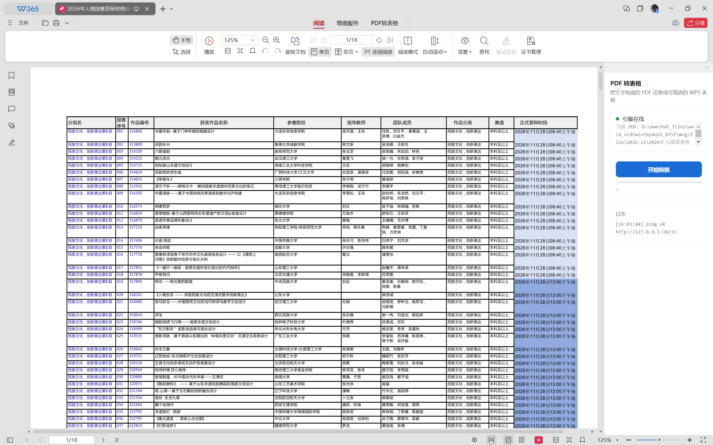

# WPSPDF

把「文字已转曲、WPS 搜不到」的 PDF 表格，在 **WPS 里点一下**还原成可筛选的 WPS 表格。

适用对象：WPS（macOS 版）导出 PDF 时把文字转成曲线轮廓的文件——文本层为空、字体表为空，
所以任何「搜索 / 复制」都失效。本项目用**矢量框线 + OCR**把它重建为 xlsx。

## 效果

| PDF 窗口页签 | 任务窗格 |
|---|---|
|  |  |

实测样本：18 页、0 字体、0 文本对象、约 1100 条矢量路径/页的汇总表 →
**578 行 × 10 列的 xlsx**，首次约 2 分钟（CPU），**同一份文件重转约 10–20 秒**（页级 OCR 缓存）。

数据核对（v1.3.0）：国赛序号 1–568 连续无断点；「正式答辩时段」568/577 行有值
（9 行空白是原 PDF 自带的分组间隔行）；日志中「有墨但没识别出文字」为 0。

## 怎么用

1. 双击 `tools/start-engine.bat`（或让加载项自己拉起，见「引擎生命周期」）
2. 用 WPS 打开 PDF → 点页签 **「PDF转表格」** → 点 **「转成 WPS 表格」**
3. 右侧窗格显示进度与预计剩余时间，完成后自动用 WPS 表格打开产物

其他入口：
- 把 PDF 拖到 `tools/convert-here.bat` 上
- 置顶悬浮条：`tools/start-floatbar.bat`（贴在 WPS 窗口右上角）

## 组成

```
addon/            WPS 表格加载项（publish.xml 里 type="et"）
addon-pdf/        WPS PDF 加载项（publish.xml 里 type="pdf"）——PDF 窗口里的页签靠它
engine/
  server.py       本地引擎：静态托管 + 转换任务队列 + ETA + 打开产物（127.0.0.1:38731）
  convert.py      PDF → xlsx（矢量框线网格 + RapidOCR + openpyxl）
  grid.py         从矢量线条提取行列边界（坐标精确，不受 OCR 误差影响）
  floatbar.py     置顶悬浮条（备用入口）
tools/            install.ps1 / uninstall.ps1 / start-engine.bat / engine-silent.vbs / convert-here.bat
docs/             Project.md / Progress.md / REQUIREMENTS.md / CHANGELOG.md
evidence/         基线快照、关键截图、P0 实测结论
```

## 安装 / 卸载

```powershell
# 安装（写 %APPDATA%\kingsoft\wps\jsaddons\WPSPDF_1.0.0 + publish.xml 条目）
tools\install.ps1

# 完全卸载（删目录、清条目、空目录一并移除）
tools\uninstall.ps1
```

安装前状态会记录到 `evidence/install-pre-*.json`，卸载后 `jsaddons` 回到安装前状态。
**不写注册表、不改 WPS 安装目录、不动用户文件。**

## 引擎生命周期

- 只监听 `127.0.0.1`，端口 38731 起，被占用自动顺延（加载项按 38731–38734 探测）
- **空闲自动退出**：默认 300 秒；优先级 `WPSPDF_IDLE_TIMEOUT`（环境变量）> `.run/idle_timeout`（写秒数）> 300；写 `0` 表示常驻
- 加载项页面每 1.2 秒轮询 `/cmd` 会持续保活 → **WPS 开着时不会退出**；WPS 关掉后到点自动退出
- 常驻时占用约 51 MB 内存、空闲 CPU ≈0
- 加载项页面加载时会尝试 `OAAssist.ShellExecute` 拉起 `tools/engine-silent.vbs`（静默，无黑窗）

## 关键技术点（都是踩过的坑）

1. **PDF 窗口能挂加载项**：`publish.xml` 里 `type="pdf"` 的独立包才会被 PDF 组件读取；
   `type="et"` 只出现在表格窗口。参考开源实现 [LocalReadTranslate](https://github.com/Yan-ShiBo/LocalReadTranslate)。
2. **`manifest.xml` 必须有 `<Functions>` 段**，否则 WPS 只加载页面、不注册功能区页签。
3. **PDF 宿主 `Application.ribbonUI` 不可重定义** → ribbon 句柄只存模块变量。
4. **CEF 后台页会拦同步 XHR** → 一律用 `fetch`；`CreateTaskPane` 必须传带 scheme+host 的绝对 URL，否则白屏。
5. **图标被缩到约 16px 渲染**：细线条稿会消失，必须用实心/粗笔画 PNG（`getImage` 返回相对路径）。
6. 转换结果落盘用「临时文件 + 原子替换」，目标被 WPS 占用时自动改存 `<name>-HHMMSS.xlsx`。
7. **跨页列边界要取并集**：有的页只画到倒数第二列（末列右边框缺失），该列文字会被判「网格外」静默丢弃。
   用并集 + 「页内边界是否为并集子集」的结构校验补齐，版式不同的页不硬套。
8. **同一文本行的多块 OCR 必须先按 y 聚类**再按 x 排：两块 y 差 0.1pt 就会让 `(y,x)` 排序把右边块排到前面（长标题颠倒）。
9. **`text_score` 默认 0.5 会吃掉正确的短文本**（如「恒我」整页分 0.40），降到 0.35 + 低分标黄。
10. **判「格里有墨」必须内缩 1.5pt**：不内缩会把格子 1px 边框当墨，空格全变假阳性；
    单元格级补救的留白要试 `pad=2.0/0/3.0`，贴边常被判无文本。

## 已知限制

- **合并单元格**：本样本只在第 1 页末列出现「横线缺失」（视觉上纵向合并），数据按行落值——
  按行还原更好筛选，故不合并；真正跨列合并的版式（一格横跨两列）尚未支持。
- **低置信度格**：低于 0.55 的格子标黄，并在 **「需校对」工作表**列出页码/行列/内容/置信度。
  这类多是 OCR 模型极限（如 `胡赟` 读成 `胡`、`刘峥` 读成 `郸区`），需要人工确认而不是再猜一次。
- **纯扫描件**（整页位图、无矢量框线）网格会退化成页框，需后续单独处理。
- **速度**：首次约 6.5 秒/页（200dpi、单进程）；页级缓存命中后整份约 10 秒。
  多进程实测无收益（onnxruntime 自身已多线程），`WPSPDF_WORKERS` 仅供实验。

## 环境

- Windows + WPS Office 12.8.2.18913（`D:\WPS Office\...\office6`）
- Python 3.13：`fitz`(PyMuPDF)、`rapidocr-onnxruntime`、`openpyxl`、`Pillow`
- Node（仅用于 `node --check` 语法自检与 `wpsjs` 参考）

## 许可

自有项目，按需自用。参考实现 LocalReadTranslate 为独立开源项目，本项目未复制其代码，仅按其公开记录校正了 WPS PDF 加载项的注册方式。
