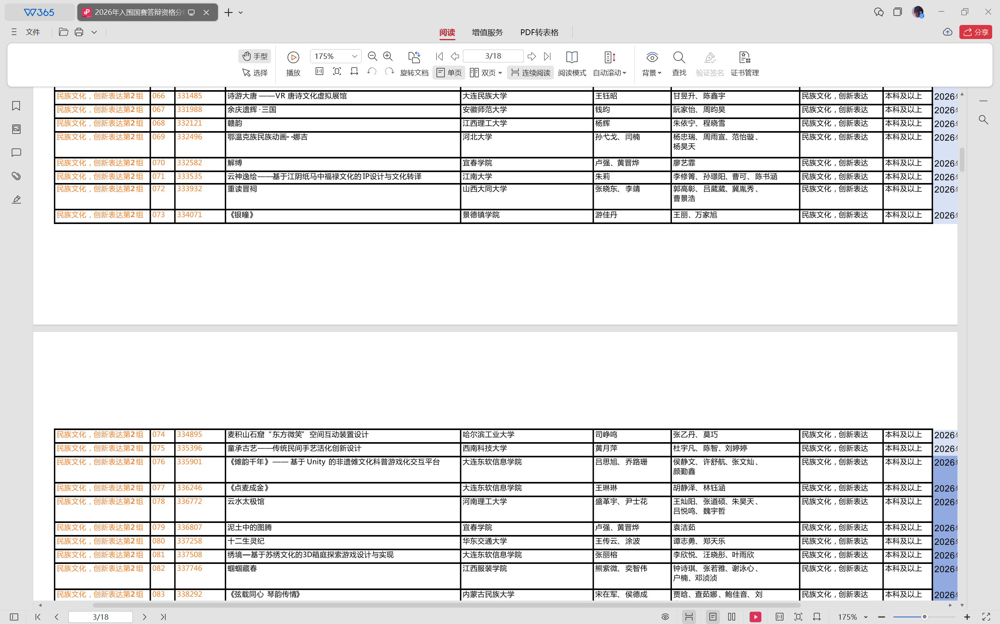

# WPSPDF

把「文字已转曲、WPS 搜不到」的 PDF 表格，在 **WPS 里点一下**还原成可筛选的 WPS 表格。

适用对象：WPS（macOS 版）导出 PDF 时把文字转成曲线轮廓的文件——文本层为空、字体表为空，
所以任何「搜索 / 复制」都失效。本项目用**矢量框线 + OCR**把它重建为 xlsx。

## 效果

| PDF 窗口页签 | 任务窗格 |
|---|---|
|  |  |

实测样本：18 页、0 字体、0 文本对象、约 1100 条矢量路径/页的汇总表 →
**578 行 × 10 列的 xlsx**，首次约 2 分钟（CPU），**同一份文件重转约 10–20 秒**（页级 OCR 缓存）。

数据核对（v1.3.0）：国赛序号 1–568 连续无断点；「正式答辩时段」568/577 行有值
（9 行空白是原 PDF 自带的分组间隔行）；日志中「有墨但没识别出文字」为 0。

## 怎么用（一句话版）

**右键 PDF →「PDF 转表格（WPSPDF）」** → 自动起引擎并用 WPS 打开 → 点页签 **「PDF转表格」**
→ 窗格里点 **「开始转换」** → 进度/预计剩余时间在窗格显示，完成后自动用 WPS 表格打开产物。

其他入口：
- 只起引擎：`tools/start-engine.bat`；看状态：`tools/check-engine.bat`
- 把 PDF 拖到 `tools/convert-here.bat` 上
- 置顶悬浮条：`tools/start-floatbar.bat`（贴在 WPS 窗口右上角，备用）
- 想让窗格里直接有「启动引擎」按钮：`pwsh tools\install-loader.ps1 -Action register`（可选，见「入口与启停」）

## 组成

```
addon/            WPS 表格加载项（publish.xml 里 type="et"）
addon-pdf/        WPS PDF 加载项（publish.xml 里 type="pdf"）——PDF 窗口里的页签靠它
engine/
  server.py       本地引擎：静态托管 + 转换任务队列 + ETA + 打开产物（127.0.0.1:38731）
  convert.py      PDF → xlsx（矢量框线网格 + RapidOCR + openpyxl）
  grid.py         从矢量线条提取行列边界（坐标精确，不受 OCR 误差影响）
  floatbar.py     置顶悬浮条（备用入口）
tools/            install.ps1 / uninstall.ps1 / start-engine.bat / engine-silent.vbs / convert-here.bat
docs/             Project.md / Progress.md / REQUIREMENTS.md / CHANGELOG.md
evidence/         基线快照、关键截图、P0 实测结论
```

## 安装 / 卸载

```powershell
# 安装（写 %APPDATA%\kingsoft\wps\jsaddons\WPSPDF_1.0.0 + publish.xml 条目）
tools\install.ps1

# 完全卸载（删目录、清条目、空目录一并移除）
tools\uninstall.ps1
```

安装前状态会记录到 `evidence/install-pre-*.json`，卸载后 `jsaddons` 回到安装前状态。
**不写注册表、不改 WPS 安装目录、不动用户文件。**

## 入口与启停（v1.6：零常驻 + PDF 右键菜单）

**页签不依赖任何服务**。PDF 侧加载项装的是官方「离线本地包」：

```
%APPDATA%\kingsoft\wps\jsaddons\WPSPDFPdf_1.0.0\      ← 加载项文件（ribbon.xml / 页面 / 图标）
publish.xml: <jsplugin name="WPSPDFPdf" type="pdf" url="WPSPDFPdf_1.0.0" version="1.0.0" .../>
```
`url` 是**目录名**而不是网址（依据 wpsjs `build.js:163`），所以 WPS 从磁盘读 `ribbon.xml` 与页面
→ **引擎不启动也有「PDF转表格」页签**（`evidence/offline-localpkg-tabrow.png`）。

**默认零常驻**：不装任何常驻进程、不留计划任务、不开机自启。入口放在 Windows 侧：

| 入口 | 做什么 |
|---|---|
| **右键 PDF →「PDF 转表格（WPSPDF）」**（默认） | 起引擎（约 3 秒）→ 用 WPS 打开该 PDF → 转完引擎 20 秒自退 |
| `tools\start-engine.bat` | 只起引擎（不打开文件） |
| `tools\check-engine.bat` | 看引擎在不在线 |

菜单项带专用图标 `addon-pdf/images/wpspdf.ico`（16~256 九尺寸；预览 `evidence/menu-icon-128.png`）。
若图标没刷新，重启一次资源管理器即可（Windows 图标缓存）。

**可选加装「窗格一键启动」**：加载项页面**无法创建进程**（实测 7 条通道全废，见关键技术点 13、15），
页面只能发 HTTP，所以想要按钮真能用，就需要一层能被 HTTP 调用的极轻服务：

```powershell
pwsh tools\install-loader.ps1 -Action register   # 装：27 MB / CPU 0，LOGIN 自启
pwsh tools\install-loader.ps1 -Action unregister # 卸：回到零常驻
```
装后：窗格「启动引擎」→ `POST 127.0.0.1:38730/start` → 加载器创建进程 → 引擎就绪（实测 **3.7 秒**）。
这层结构参考 [LocalReadTranslate iteration-14](https://raw.githubusercontent.com/Yan-ShiBo/LocalReadTranslate/main/docs/iteration-14-2026-07-29-addin-on-demand-startup.md)。

## 关闭 PDF 时的现象（与插件无关，已 A/B 验证）

关闭这份大 PDF 后，WPS 会留下一个空的「WPS Office」窗口，进程不退出；
**关掉那个空窗口，进程 1 秒退出**。禁用加载项后重复同一操作，行为完全一样
（`evidence/` 与 CHANGELOG v1.3.2 记录），所以这是 WPS 自身行为，不是插件卡死。
插件侧另做了 hygiene：`beforeunload`/`pagehide` 时停轮询、不再发请求，不给宿主拆除页面添等待。

## 引擎生命周期

- 只监听 `127.0.0.1`，端口 38731 起，被占用自动顺延（加载项按 38731–38734 探测）
- **不常驻**：只有右键菜单 / 快捷方式 / 加载器请求时才起来；`.run/idle_timeout`（默认 20 秒）到点自行退出。
  判活只看**文档进程**（`wpspdf/et/wpp/wps`），不含 `wpsoffice.exe`——它关文档后会留空壳窗口，
  用它会把这引擎焊死
- 开机自启已**取消**（`tools/autostart.ps1 -Action unregister`），因为页签不再需要引擎先起
- 运行期间占用约 51 MB 内存、空闲 CPU ≈0
- 加载项**不会**用 `wps.OAAssist.ShellExecute` 拉起引擎：通道实测全部无效，见关键技术点 11、13

## 关键技术点（都是踩过的坑）

1. **PDF 窗口能挂加载项**：`publish.xml` 里 `type="pdf"` 的独立包才会被 PDF 组件读取；
   `type="et"` 只出现在表格窗口。参考开源实现 [LocalReadTranslate](https://github.com/Yan-ShiBo/LocalReadTranslate)。
2. **`manifest.xml` 必须有 `<Functions>` 段**，否则 WPS 只加载页面、不注册功能区页签。
3. **PDF 宿主 `Application.ribbonUI` 不可重定义** → ribbon 句柄只存模块变量。
4. **CEF 后台页会拦同步 XHR** → 一律用 `fetch`；`CreateTaskPane` 必须传带 scheme+host 的绝对 URL，否则白屏。
5. **图标被缩到约 16px 渲染**：细线条稿会消失，必须用实心/粗笔画 PNG（`getImage` 返回相对路径）。
6. 转换结果落盘用「临时文件 + 原子替换」，目标被 WPS 占用时自动改存 `<name>-HHMMSS.xlsx`。
7. **跨页列边界要取并集**：有的页只画到倒数第二列（末列右边框缺失），该列文字会被判「网格外」静默丢弃。
   用并集 + 「页内边界是否为并集子集」的结构校验补齐，版式不同的页不硬套。
8. **同一文本行的多块 OCR 必须先按 y 聚类**再按 x 排：两块 y 差 0.1pt 就会让 `(y,x)` 排序把右边块排到前面（长标题颠倒）。
9. **`text_score` 默认 0.5 会吃掉正确的短文本**（如「恒我」整页分 0.40），降到 0.35 + 低分标黄。
10. **判「格里有墨」必须内缩 1.5pt**：不内缩会把格子 1px 边框当墨，空格全变假阳性；
    单元格级补救的留白要试 `pad=2.0/0/3.0`，贴边常被判无文本。
11. **PDF 宿主里绝不能反复调 `wps.OAAssist.ShellExecute`**：WPS 个人版静默拦截该调用，
    同步进宿主内部会把 PDF 窗口拖到卡死（2026-11-26 实测：引擎空闲退出后旧版每 15 秒调一次，窗口冻死）。
    页面改为「失败只退避、不拉起进程」，并且**不要用同步 XHR**（`xhr.open(...,false)` 在 CEF 后台页会被拦）。
12. **`增值服务` 是 WPS 自带页签**，第三方加载项无法往里插按钮；只能并列一个自己的页签
    （实测页签行为 `阅读 | 增值服务 | PDF转表格`）。
13. **加载项页面无法启动进程**（2026-11-27 在活的 PDF 宿主里逐条实测，不是猜）：
    - `wps.OAAssist.ShellExecute(...)` → 返回正常、**不执行**（用写文件验证，文件没出现）
    - `Application.CreateObject("WScript.Shell")` → `Load dll fail! Please check the dll path.`
    - `wps.CreateObject(...)` → 同上
    - `wps.OAAssist.CoCreateInstance("WScript.Shell")` → `WScript.Shell can not create`
    所以「在 WPS 里点按钮启动引擎」这条路在本版本 WPS 上封死，按需启动只能放在 Windows 侧。
14. **离线本地包格式**（让页签不依赖服务）：`publish.xml` 里
    `<jsplugin url="<Name>_<Version>" version="<Version>"/>`，`url` 是 `jsaddons` 下的**目录名**；
    目录内容就是加载项文件。见 wpsjs `src/lib/build.js:163` 的 `CreatePublishXml()`。

## 已知限制

- **合并单元格**：本样本只在第 1 页末列出现「横线缺失」（视觉上纵向合并），数据按行落值——
  按行还原更好筛选，故不合并；真正跨列合并的版式（一格横跨两列）尚未支持。
- **低置信度格**：低于 0.55 的格子标黄，并在 **「需校对」工作表**列出页码/行列/内容/置信度。
  这类多是 OCR 模型极限（如 `胡赟` 读成 `胡`、`刘峥` 读成 `郸区`），需要人工确认而不是再猜一次。
- **纯扫描件**（整页位图、无矢量框线）网格会退化成页框，需后续单独处理。
- **速度**：首次约 6.5 秒/页（200dpi、单进程）；页级缓存命中后整份约 10 秒。
  多进程实测无收益（onnxruntime 自身已多线程），`WPSPDF_WORKERS` 仅供实验。

## 环境

- Windows + WPS Office 12.8.2.18913（`D:\WPS Office\...\office6`）
- Python 3.13：`fitz`(PyMuPDF)、`rapidocr-onnxruntime`、`openpyxl`、`Pillow`
- Node（仅用于 `node --check` 语法自检与 `wpsjs` 参考）

## 许可

自有项目，按需自用。参考实现 LocalReadTranslate 为独立开源项目，本项目未复制其代码，仅按其公开记录校正了 WPS PDF 加载项的注册方式。

15. **页面无法创建进程时的正解是「轻量加载器」**：页面只能发 HTTP，所以需要一个只做标准库、
    不加载模型的本地小服务（本项目 `engine/loader.py`，27 MB）来替它创建进程。
    这层是参考实现同样要付的成本；不想付就走零常驻入口（右键菜单 / 快捷方式）。
